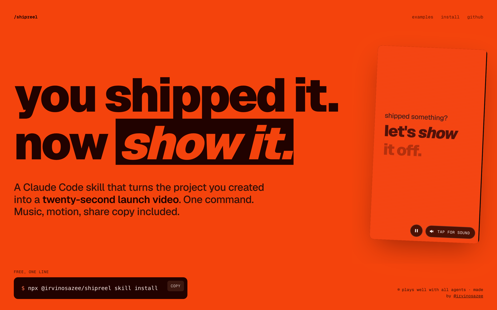

# /shipreel

**You shipped it. Now show it.**

[](https://irvinosazee.github.io/shipreel/)

`/shipreel` is a Claude Code skill that turns the project you created into a short, shareable launch video — music, motion, and share copy included. One command, powered by [Hyperframes](https://hyperframes.heygen.com/).

The looping video on the [launch site](https://irvinosazee.github.io/shipreel/) was made by `/shipreel` on this very repo. 

> **Built on [/brag](https://github.com/latent-spaces/brag) by [Shunit Haviv Hakimi](https://github.com/shunithaviv).**
> Her project is the original: the idea, the tone, the example suite, and the first version of this skill are hers.
> `shipreel` is a fork that grew well past it — see [what changed](#what-changed-since-the-fork).
> The whole project is MIT, under [`LICENSE`](LICENSE), carrying both copyrights.

## What it does

- Checks its own work: every render is measured for loudness, phone-legible text, safe zones and contrast before you post it.
- Every screen: one plan becomes a ready-to-upload file for 26 platforms, reflowed, not cropped.
- Claims you can back up: every number on screen is cited to a file in your repo.
- Videos that keep coming: a release video for every git tag and a before/after clip for every pull request.

## Install

Free and open source (MIT). One line, if you have Node 22+:

```bash
npx @irvinosazee/shipreel skill install
```

That puts the skill in `~/.claude/skills/shipreel`. Restart Claude Code and say `let's /shipreel`.

Other ways in:

```bash
# Claude Code plugin marketplace
/plugin marketplace add irvinosazee/shipreel
/plugin install shipreel@shipreel

# the standalone CLI, for people without a coding agent
npm i -g @irvinosazee/shipreel
shipreel make

# one project, for Claude Code, Codex and opencode at once
npx @irvinosazee/shipreel skill install --project . --agent all
```

The last one installs one copy and links the other two to it, because the bundled audio is 16MB.
`shipreel skill where` prints the paths without touching anything. `shipreel doctor` checks Node,
FFmpeg, Hyperframes and the bundled audio, and says what is missing.

> The unscoped `shipreel` package on npm is somebody else's. This one is always
> `@irvinosazee/shipreel`.

### Updating

```bash
npx @irvinosazee/shipreel@latest skill install   # refreshes the skill in place
npm i -g @irvinosazee/shipreel@latest            # if you use the CLI
/plugin marketplace update shipreel              # if you installed the plugin
```

Releases, with a video of what changed, are on the [releases page](https://github.com/irvinosazee/shipreel/releases).

### Stay in the loop

If shipreel made you a video you posted, **[star the repo](https://github.com/irvinosazee/shipreel)** —
it is how other people find it. **Watch → Custom → Releases** gets you one notification per release.
To follow what I build next: [GitHub](https://github.com/irvinosazee) ·
[LinkedIn](https://www.linkedin.com/in/irvin-osazee) · [Medium](https://medium.com/@uyiosazeeirvin) ·
[irvinosazee.me](https://www.irvinosazee.me).

### Also works with

This repo exposes the skill at every agent's standard discovery path via symlinks. No extra config needed.

| Agent | How it discovers |
|---|---|
| **opencode** | Auto-detects from `.opencode/skills/shipreel/` at project root |
| **Codex CLI** | Reads `.agents/skills/shipreel/`, walking up to repo root |
| **Claude Code** | Reads `.claude/skills/shipreel/`, or `~/.claude/skills/shipreel/` for every project |
| **Other agents** | Point custom instructions at `skills/shipreel/SKILL.md` — see [`docs/other-agents.md`](docs/other-agents.md) |

> **Windows users:** Git requires `git config core.symlinks true` (or `git clone -c core.symlinks=true`) and Windows Developer Mode or Administrator privileges to create symlinks. If symlinks don't work on your system, copy `skills/shipreel/` to the agent's skill directory manually instead.

## Use it

The full guide — every flag, every output file, troubleshooting — is the [manual](docs/manual.md).

From any project directory, ask your agent:

```text
let's /shipreel
```

Or steer the tone:

```text
/shipreel --tone "fake Series A launch from 2016"
```

Post it everywhere — one plan, a layout for every screen, captions, and a ready-to-upload file per platform:

```text
/shipreel --for tiktok,reels,shorts,x,linkedin
```

Vertical renders respect each app's buttons and caption areas, Discord and README exports are squeezed under 10 MB, and the README export comes with an autoplaying GIF.

Voiceover is off by default. Enable it explicitly with:

```text
/shipreel --voice
```

Narration uses Kokoro through Hyperframes when enabled.

You get a `shipreel-output/` folder with the plan, a composition brief, a self-review, share copy, and the rendered `shipreel.mp4` (plus `exports/` and captions when you use `--for`).

### Ship it

```text
/shipreel --for tiktok,reels,x --images --kit --embed
```

`--images` renders the launch images from the same run, in your project's own palette and fonts and showing its real frames: a link preview, an X image, a GitHub social preview, a Product Hunt gallery, and a LinkedIn carousel with its PDF. Each one is checked like the video is (exact size, file budget, legibility, contrast, cited claims). `--kit` bundles every video, the covers, Product Hunt gallery images, an X thread, a LinkedIn post, README and HTML embed snippets, and credits into `shipreel-output/launch-kit/` (and a zip). `--embed` writes a patch that puts the video, with its poster, under the first headline of your landing page (Next.js, Astro, SvelteKit, Vite, Vue, plain HTML, or the README). Nothing is posted anywhere.

### Without an agent

`shipreel` is the same toolkit as a plain CLI. It fills a clean card template from your package metadata, README, git history, and a capture of the running site; it does not write a bespoke video the way the skill does.

```bash
npx @irvinosazee/shipreel make ~/code/my-app --format vertical
npx @irvinosazee/shipreel release ~/code/my-app --tag v1.2.0 --out shipreel-release
npx @irvinosazee/shipreel --help
```

### In GitHub Actions

Release videos attached to every GitHub release, and before/after preview clips commented on pull requests:

```bash
npx @irvinosazee/shipreel github install release      # or: pr-preview
```

Both use the composite action in `action.yml` (`uses: irvinosazee/shipreel@main`) and only the workflow token. The PR preview needs a `SHIPREEL_PRODUCTION_URL` repository variable. See [distribution.md](skills/shipreel/references/distribution.md).

## How it works

`/shipreel` owns the story — the product angle, tone, and which moments to show. It hands a focused brief to [Hyperframes](https://hyperframes.heygen.com/), which builds, times, and renders the video.

## Requirements

- An agent that supports Agent Skills — Claude Code, opencode, Codex CLI, or any agent with custom instructions (see "Also works with" above)
- Node.js 22+
- FFmpeg on `PATH`
- Hyperframes CLI — `npx hyperframes` (check it with `npx hyperframes doctor`)

Check everything at once, including the bundled music and SFX:

```bash
npx @irvinosazee/shipreel doctor
```

`/shipreel` runs the same check before every video and tells you what it will skip.

## What's in this repo

- `skills/shipreel/` — the skill, references, and bundled music + SFX
- `examples/` — fake product sites used as a benchmark suite
- `docs/` — the launch site (GitHub Pages)
- `tests/` — Node test suite (`npm test`) and the examples eval baseline
- `scripts/` — repo checks: `npm run validate` (manifests, symlinks, links), `npm run eval` (examples vs. baseline), `npm run check:docs`, `npm run pack-cli` (stages and packs the `@irvinosazee/shipreel` npm package into `dist/`, without publishing)
- `action.yml` — composite GitHub Action for release videos and PR previews
- `.github/workflows/ci.yml` — runs all of the above on every push and pull request
- `.github/workflows/nightly-render.yml` — renders a fixture nightly with the latest Hyperframes and verifies it
- `ROADMAP.md` — backlog and feature ideas
- `.claude-plugin/` — plugin manifest, for installing this clone as a local Claude Code plugin
- `.claude/skills/shipreel/` — symlink → `skills/shipreel/` (Claude Code discovery)
- `.agents/skills/shipreel/` — symlink → `skills/shipreel/` (Codex CLI + opencode discovery)
- `.opencode/skills/shipreel/` — symlink → `skills/shipreel/` (opencode discovery)

## Publishing it

Releasing it, the site, and the launch post: [PUBLISHING.md](PUBLISHING.md).

## What changed since the fork

The original `/brag` was a prompt-and-assets skill: it told an agent how to make one landscape video. `shipreel` turns that into a pipeline that checks its own work.

| | /brag (original) | shipreel |
|---|---|---|
| Skill scripts | 1 | 40 |
| Tests | none | 297, on every push |
| Reference docs | 6 | 15 |
| Output | one landscape video | every frame size, per-platform exports, captions, covers, cutdowns, stories, carousels, launch images |
| Verification | none | render verified (duration, frame size, audio, loudness, baked poster), on-screen text audited for legibility and reading time, contrast checked, golden-frame regression, nightly render against the latest Hyperframes; launch images and launch copy checked against each platform's limits |
| Source material | reads the project's code | also captures the running site, cuts real screen recordings, and cites every on-screen claim to a source file |
| Distribution | manual | launch kit, site-embed patch, release videos from git tags, PR preview clips, GitHub Action, standalone CLI |

Same idea, same spirit, much longer leash. Full history in [ROADMAP.md](ROADMAP.md).

## Credits

- Original project — [**/brag**](https://github.com/latent-spaces/brag) by [Shunit Haviv Hakimi](https://github.com/shunithaviv), MIT
- Music — [ende.app](https://ende.app/en) "Happy Beats / Business Moves"
- Sound effects — [Kenney](https://kenney.nl/)
- Video generation — [Hyperframes](https://hyperframes.heygen.com/)
- Fake demo sites — built with [Impeccable](https://impeccable.style/)

## Contributing

Contributions, ideas, and new demo reels are welcome — open an issue or a PR.

Before opening a PR, run `npm test && npm run validate && npm run eval` (Node 22+ and FFmpeg). If you fix an example's render, run `node scripts/eval-examples.mjs --update-baseline` so the fix is locked in; after an intended visual change to an example, re-capture its reference frames with `--update-golden`.

`npm run render-smoke` renders a small fixture with the latest Hyperframes and checks it end to end (the same check runs nightly in `.github/workflows/nightly-render.yml`).
